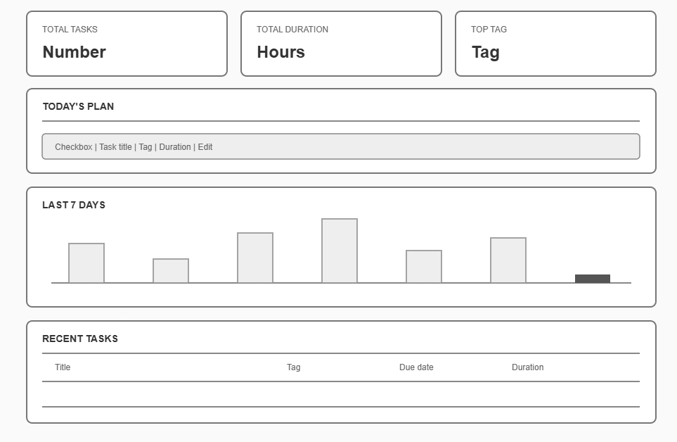
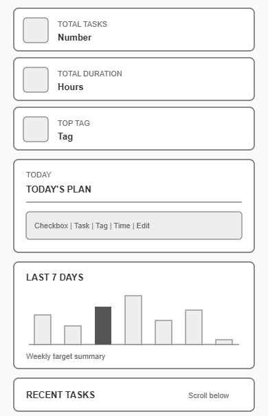
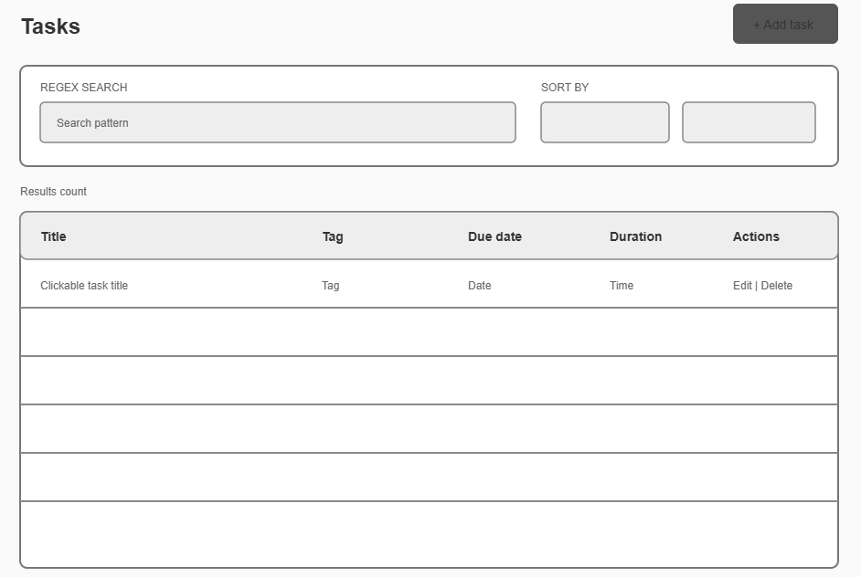

# Campus Planner 
A student campus life planner.

## Project description
- This project helps students to organise their tasks and different events like studying, sports and clubs.
- The project can help sort tasks by due dates, durations, tags.
 
## Website users
- The project is for students using phones and laptops or tablets (works on both phone and website)

## Core features
- Dashboard  
- tasks      
- Settings
- About

## Data model
```js
{
  id: "001",
  title: "E-lab Project meeting",
  duration: 30,
  dueDate: "2026-10-09",
  tag: "Study",
  completed: True,
  note: "Visiting Primary school",
  createdAt: "2026-10-01",
  updatedAt: "..."
}
```
## Responsive design
The campus planner has sidebar on desktop and table like for tasks which shows as cards on mobile.

## Accesibility plan
- keyborad access: keyboard keys can help navigate in case screen is not working.
- labelled form fields: This helps the user to navigate without guessing whats next
- Semantic landmarks: Html tags directs us to the next sections of the page
- visible focus
- screen reader compatibility: to guide users who have visual disability by reading for them

## Wireframes
 
- A navigation, three statistics, Today's Plan, seven-day bars, and recent tasks

 
- A compact brand row, theme icons, stacked content, and fixed bottom navigation.

 
- Add task, regex (search, sort and record table)
